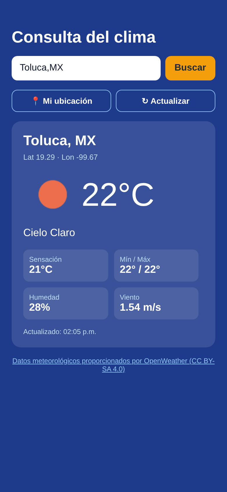
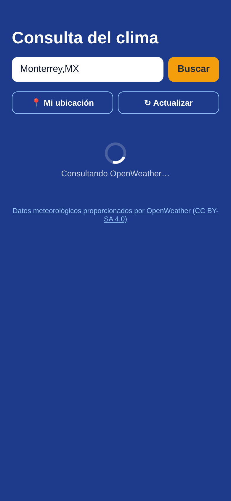
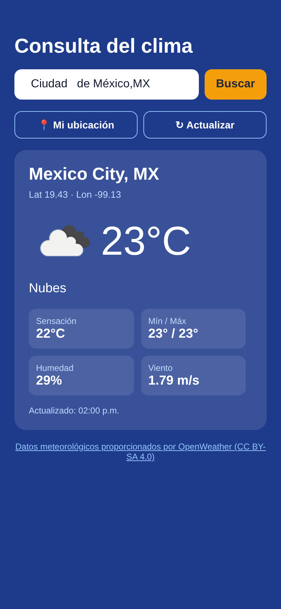
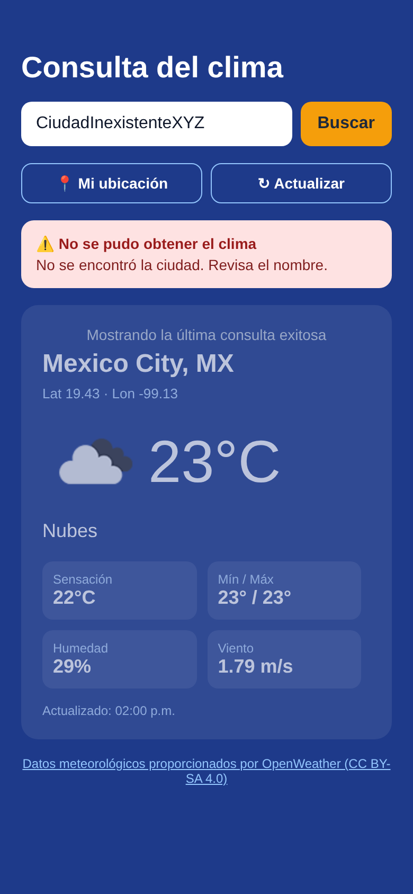
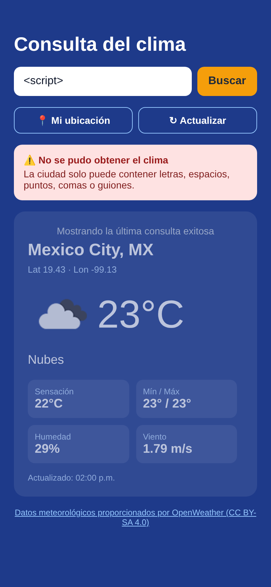
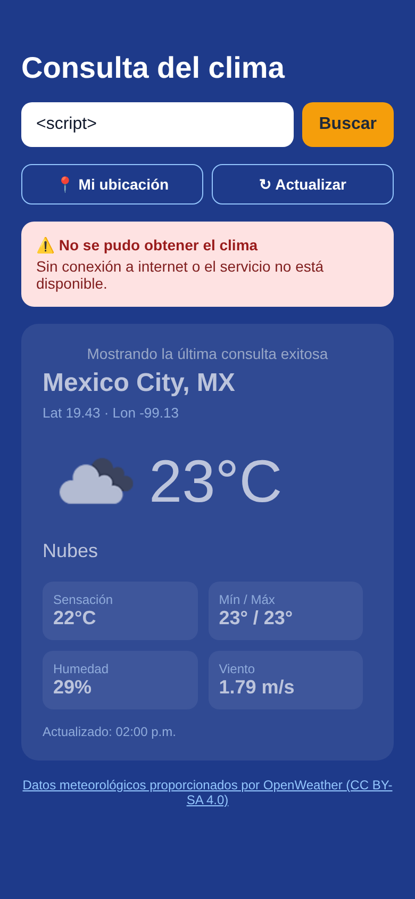

# Clima App: prototipo móvil de consulta meteorológica

Prototipo móvil (React Native + Expo) que consulta la API de **OpenWeather**, procesa la respuesta JSON y muestra temperatura, condiciones del clima y ubicación. No usa una base de datos propia: toda la información viene del servicio externo.

**Opción elegida:** A. Consulta meteorológica

---

## 1. Ejecución del proyecto

```bash
cd clima-app
npm install
cp .env.example .env        # y colocar la API key de OpenWeather
npx expo start              # escanear el QR con Expo Go (Android/iOS)
npx expo start --web        # o abrir la versión web en el navegador
```

| Tecnología | Versión |
|---|---|
| Expo SDK | 58 |
| React Native | 0.88 |
| expo-location | 58 (para "Mi ubicación") |

### Estructura

```
clima-app/
├── App.js                 # Pantalla principal (UI, estados de carga/error)
├── src/weatherService.js  # Cliente HTTP: validación, GET, parseo y manejo de errores
├── .env.example           # Plantilla de variables de entorno (sin clave real)
├── .env                   # Clave real: NO se sube al repositorio (.gitignore)
├── app.json               # Configuración Expo + permiso de ubicación
└── docs/capturas/         # Capturas de pantalla para la entrega
```

---

## 2. Identificación y documentación de la API

| Concepto | Detalle |
|---|---|
| Proveedor | OpenWeather (https://openweathermap.org) |
| API | Current Weather Data 2.5 (https://openweathermap.org/current) |
| Endpoint | `https://api.openweathermap.org/data/2.5/weather` |
| Método HTTP | `GET` |
| Protocolo | HTTPS |
| Autenticación | API key en el parámetro `appid` (requiere registro gratuito) |
| Plan | Free: 60 llamadas/minuto, 1,000,000 llamadas/mes |
| Licencia de datos | CC BY-SA 4.0; **requiere atribución** a OpenWeather |

### Parámetros utilizados

| Parámetro | Uso |
|---|---|
| `q` | Nombre de ciudad, opcionalmente con país: `Toluca,MX` |
| `lat`, `lon` | Coordenadas (botón "Mi ubicación") |
| `units=metric` | Temperatura en °C y viento en m/s |
| `lang=es` | Descripción del clima en español |
| `appid` | API key |

### Estructura de la respuesta (campos que usa la app)

```json
{
  "coord":   { "lon": -99.6672, "lat": 19.2883 },
  "weather": [{ "description": "cielo claro", "icon": "01d" }],
  "main":    { "temp": 17.39, "feels_like": 16.62, "temp_min": 17.39,
               "temp_max": 17.39, "humidity": 55 },
  "wind":    { "speed": 2.1 },
  "dt": 1793462400,
  "sys":     { "country": "MX" },
  "name":    "Toluca",
  "cod":     200
}
```

### Campos mostrados en la interfaz

1. **Ubicación**: ciudad, país y coordenadas (`name`, `sys.country`, `coord`)
2. **Temperatura**: actual, sensación térmica, mínima y máxima (`main.*`)
3. **Condición del clima**: descripción e ícono (`weather[0]`)
4. Extras: humedad, velocidad del viento y hora de actualización

### Códigos de respuesta manejados

| Código | Significado | Mensaje en la app |
|---|---|---|
| 200 | OK | Muestra los datos |
| 401 | API key inválida o no activada | "Clave de API inválida o aún no activada." |
| 404 | Ciudad no encontrada | "No se encontró la ciudad. Revisa el nombre." |
| 429 | Límite de solicitudes excedido | "Se alcanzó el límite de solicitudes…" |
| 5xx | Falla del servidor | "El servicio meteorológico no está disponible por ahora." |
| — | Sin red / timeout de 10 s | "Sin conexión…" / "El servicio tardó demasiado…" |
| 200 sin datos | JSON vacío o incompleto | "La API devolvió una respuesta vacía o incompleta." |

---

## 3. Funcionalidad implementada

| Requisito | Implementación |
|---|---|
| Solicitar información mediante GET | `fetch(..., { method: 'GET' })` en `src/weatherService.js` |
| Procesar la respuesta JSON | `parseWeather()` convierte el JSON a un objeto para la UI |
| Mostrar al menos 3 campos | Ubicación, temperatura y condición (+ humedad, viento, mín/máx) |
| Actualizar o buscar | Búsqueda por ciudad, botón "Actualizar", *pull-to-refresh* y "Mi ubicación" |
| Indicadores de carga y errores | `ActivityIndicator` y un recuadro de error con el mensaje específico |

Si una consulta falla después de una exitosa, la app conserva la última información válida (atenuada) y muestra el error encima.

---

## 4. Medidas de seguridad y validación

1. **HTTPS obligatorio**: todas las peticiones (datos e íconos) usan `https://`.
2. **La clave no está en el código fuente**: se lee de `process.env.EXPO_PUBLIC_OPENWEATHER_API_KEY`, definida en `.env`. El archivo `.env` está en `.gitignore` y el repositorio solo incluye `.env.example` con un valor de ejemplo.
   - *Limitación conocida:* en Expo, las variables `EXPO_PUBLIC_*` se incrustan en el bundle de la app compilada. Para una clave gratuita en un prototipo esto es aceptable. En producción, la app debería llamar a un backend propio (proxy) que guarde la clave en el servidor y aplique su propio límite de solicitudes.
3. **Validación de parámetros** antes de llamar a la API:
   - Ciudad: se eliminan espacios sobrantes, debe tener entre 2 y 60 caracteres y solo puede incluir letras (con acentos/ñ), espacios, `.` `,` `'` `-`. Se rechazan entradas como `<script>`, números o símbolos.
   - Coordenadas: deben ser numéricas, con latitud en [-90, 90] y longitud en [-180, 180].
   - Los parámetros se codifican con `URLSearchParams` para evitar la inyección en la URL.
   - El campo de texto limita la entrada a 60 caracteres (`maxLength`).
4. **Disponibilidad del servicio**: timeout de 10 s con `AbortController` y mensajes específicos para falta de conexión, 429 (límite de solicitudes), 5xx y respuestas vacías. Los botones se desactivan mientras hay una consulta en curso para evitar ráfagas de solicitudes.
5. **Permisos mínimos**: solo se solicita la ubicación *en primer plano* y únicamente cuando el usuario pulsa "Mi ubicación". Si la niega, la app sigue funcionando con la búsqueda por ciudad.
6. **Uso permitido y atribución**: el plan gratuito permite el uso no comercial y de prototipos. Los datos tienen licencia CC BY-SA 4.0, por lo que la pantalla muestra el texto *"Datos meteorológicos proporcionados por OpenWeather"* con un enlace al sitio.

---

## 5. Casos de prueba

### Caso de prueba 1: consulta válida con acentos y país

| Campo | Detalle |
|---|---|
| **Objetivo** | Verificar que la app realiza el GET, procesa el JSON y muestra los campos. |
| **Entrada** | `  Ciudad   de México,MX ` (con espacios sobrantes y acento) |
| **Pasos** | 1. Escribir la ciudad. 2. Pulsar **Buscar**. |
| **Resultado esperado** | Se muestra un indicador de carga y después la tarjeta con ciudad *Mexico City, MX*, coordenadas, temperatura en °C, descripción en español, humedad y viento. |
| **Resultado obtenido** | HTTP 200. *Mexico City, MX* (lat 19.43, lon -99.13), **23 °C**, sensación 22 °C, "nubes", humedad 29 %, viento 1.79 m/s. ✅ |
| **Justificación** | Es el flujo principal de la app. Comprueba de una vez la normalización de la entrada (se eliminan los espacios sobrantes), la codificación de caracteres no ASCII en la URL (`é`), el parámetro `lang=es`, `units=metric` y el parseo de los campos que pide la actividad (ubicación, temperatura y condición). |
| **Evidencia** | `docs/capturas/caso1-ciudad-valida.png` |

### Caso de prueba 2: ciudad inexistente y entrada inválida

| Campo | Detalle |
|---|---|
| **Objetivo** | Verificar el manejo de errores y la validación de parámetros. |
| **Entrada A** | `CiudadInexistenteXYZ` |
| **Resultado esperado A** | La API responde 404 y la app muestra *"No se encontró la ciudad. Revisa el nombre."* sin cerrarse. |
| **Resultado obtenido A** | HTTP 404 `{"cod":"404","message":"city not found"}` → mensaje mostrado. ✅ |
| **Entrada B** | `<script>` |
| **Resultado esperado B** | La app **no** envía la petición y muestra *"La ciudad solo puede contener letras, espacios…"* |
| **Resultado obtenido B** | Rechazado por `validateCity()` antes del GET; se verificó que se enviaron **0 peticiones** a la API. ✅ |
| **Justificación** | Un usuario real se equivoca al escribir. La app debe distinguir entre un error del servidor (404) y una entrada inválida que nunca debe salir del dispositivo. Esto demuestra la validación de parámetros y el manejo de errores que pide la Parte 3, y evita gastar solicitudes del límite de la API en entradas inválidas. |
| **Evidencia** | `docs/capturas/caso2-ciudad-no-encontrada.png`, `docs/capturas/caso2-entrada-invalida.png` |

### Pruebas adicionales sugeridas para la demostración

- Activar el modo avión y pulsar **Actualizar** → mensaje de "Sin conexión…".
- Pulsar **Mi ubicación** y negar el permiso → mensaje sin cerrar la app.
- Deslizar hacia abajo (*pull-to-refresh*) → recarga la última consulta.

---

## 6. Evidencias a entregar (checklist)

- [x] Proyecto móvil funcional (este directorio)
- [x] Código fuente (`App.js`, `src/weatherService.js`)
- [x] Identificación y documentación de la API (sección 2)
- [x] Capturas de la información obtenida (sección 7)
- [x] Dos pruebas documentadas (sección 5)
- [x] Descripción de las medidas de seguridad (sección 4)
- [x] Reporte formal en PDF: [`docs/Reporte-Clima-App.pdf`](docs/Reporte-Clima-App.pdf)

---

## 7. Capturas

| Pantalla inicial | Indicador de carga | Caso 1: ciudad válida |
|---|---|---|
|  |  |  |

| Caso 2A: ciudad no encontrada | Caso 2B: entrada inválida | Extra: sin conexión |
|---|---|---|
|  |  |  |
