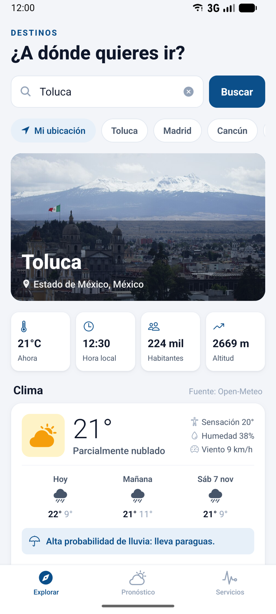
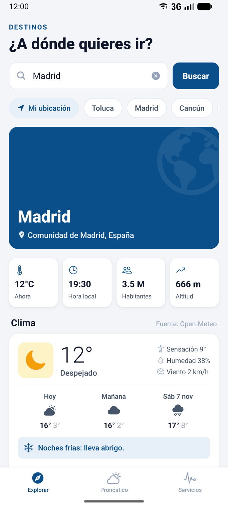
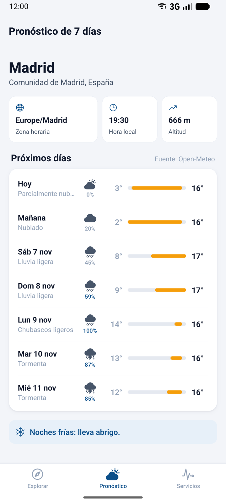
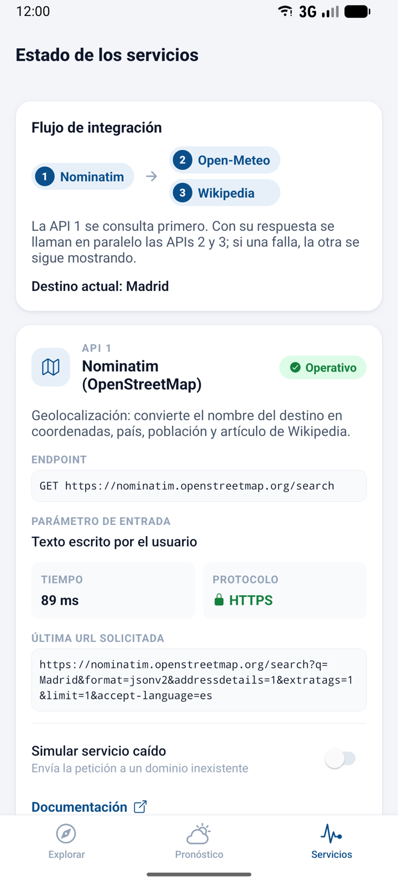
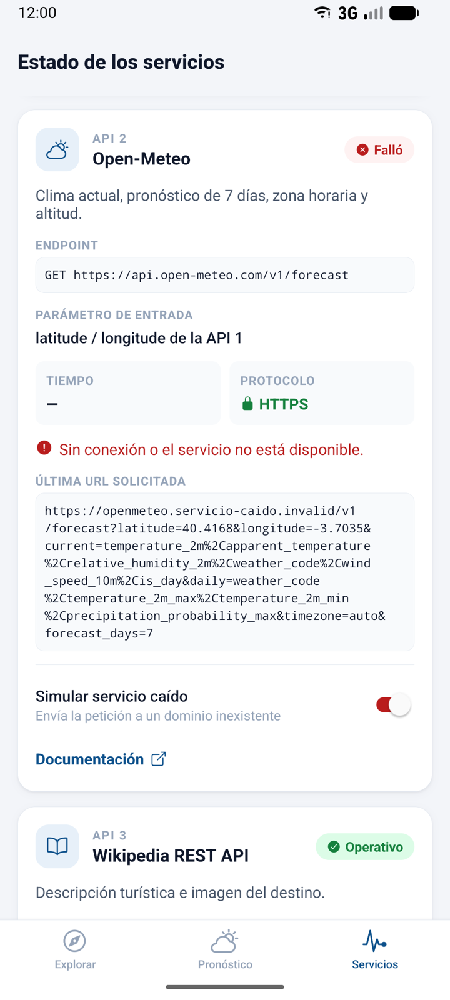
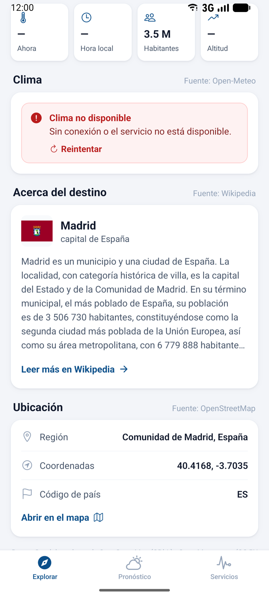
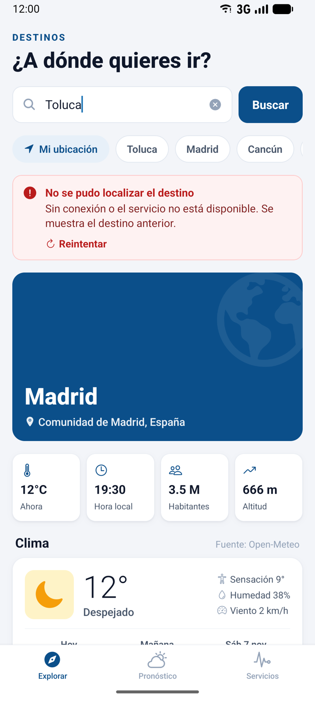
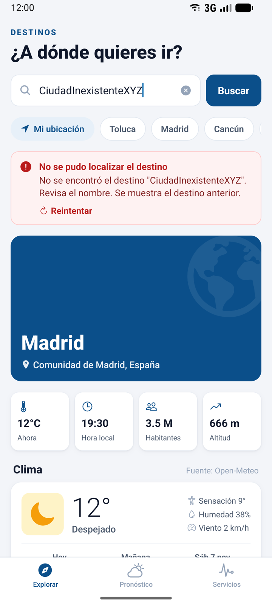
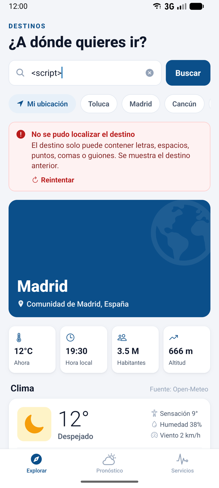

# Destinos App: integración de tres APIs de terceros

Aplicación móvil (React Native + Expo + Expo Router) para consultar **destinos turísticos**. Al buscar una ciudad, la app:

1. La localiza con **Nominatim (OpenStreetMap)**: coordenadas, país, población y artículo de Wikipedia asociado.
2. Con esas **coordenadas** consulta el clima en **Open-Meteo**.
3. Con el **artículo** que indicó OpenStreetMap consulta la descripción turística en **Wikipedia**.

Los resultados aparecen juntos en la pestaña **Explorar**. El pronóstico de 7 días está en **Pronóstico** y el estado de cada API (con un interruptor para simular una caída) en **Servicios**.

Ninguna de las tres APIs requiere clave, así que la app no guarda secretos.

> La versión anterior del proyecto (solo OpenWeather) quedó en `docs/actividad-anterior-clima/`.

---

## 1. Ejecución

```bash
npm install
npx expo start          # escanear el QR con Expo Go (Android/iOS)
npx expo start --web    # o abrir en el navegador
npx expo lint           # revisión de código
```

| Tecnología | Versión |
|---|---|
| Expo SDK | 58 |
| React Native | 0.88 |
| Expo Router | 58 (navegación por pestañas) |
| expo-location | 58 (botón "Mi ubicación") |
| expo-image | 58 (fotos de Wikipedia con caché) |

### Estructura

```
src/
├── app/                         # Rutas (Expo Router)
│   ├── _layout.js               # Provider de estado + Stack
│   └── (tabs)/
│       ├── _layout.js           # Barra de pestañas
│       ├── index.js             # Explorar: consulta e información integrada de las 3 APIs
│       ├── pronostico.js        # Pronóstico de 7 días
│       └── apis.js              # Servicios: endpoints, estado de cada petición y simulador de caída
├── context/DestinationContext.js  # Orquesta las 3 peticiones y comparte el resultado
├── services/
│   ├── http.js                  # Cliente GET común: HTTPS, timeout, errores, medición de tiempo
│   ├── geocoding.js             # API 1: Nominatim
│   ├── weather.js               # API 2: Open-Meteo
│   └── wikipedia.js             # API 3: Wikipedia REST
├── components/ui.js             # Tarjetas, estados de carga y error
└── utils/format.js
```

---

## 2. APIs utilizadas y sus endpoints

### API 1: Nominatim (OpenStreetMap). Información geográfica

| Concepto | Detalle |
|---|---|
| Documentación | https://nominatim.org/release-docs/latest/api/Search/ |
| Endpoint (búsqueda) | `GET https://nominatim.openstreetmap.org/search` |
| Endpoint (inverso, "Mi ubicación") | `GET https://nominatim.openstreetmap.org/reverse` |
| Parámetros | `q` (destino), `format=jsonv2`, `addressdetails=1`, `extratags=1`, `limit=1`, `accept-language=es` · en inverso: `lat`, `lon`, `zoom=10` |
| Autenticación | Ninguna. La política de uso pide identificar la app (User-Agent en móvil) y hacer como máximo 1 petición por segundo. |
| Formato | JSON (arreglo de lugares) |
| Licencia | ODbL, con atribución a "© colaboradores de OpenStreetMap" |

```json
[{
  "lat": "19.2925450", "lon": "-99.6569007",
  "name": "Toluca", "addresstype": "city",
  "display_name": "Toluca, Estado de México, 50000, México",
  "address": { "state": "Estado de México", "country": "México", "country_code": "mx" },
  "extratags": { "wikipedia": "es:Toluca de Lerdo", "population": "223876" }
}]
```

### API 2: Open-Meteo. Información meteorológica

| Concepto | Detalle |
|---|---|
| Documentación | https://open-meteo.com/en/docs |
| Endpoint | `GET https://api.open-meteo.com/v1/forecast` |
| Parámetros | `latitude`, `longitude` (**tomados de la API 1**), `current=temperature_2m,apparent_temperature,relative_humidity_2m,weather_code,wind_speed_10m,is_day`, `daily=weather_code,temperature_2m_max,temperature_2m_min,precipitation_probability_max`, `timezone=auto`, `forecast_days=7` |
| Autenticación | Ninguna (uso no comercial, hasta 10,000 llamadas/día) |
| Formato | JSON. `current` es un objeto y `daily` son arreglos paralelos indexados por fecha. |
| Licencia | CC BY 4.0 |

```json
{
  "timezone": "America/Mexico_City", "elevation": 2669.0,
  "current": { "time": "2026-11-04T17:00", "temperature_2m": 20.3, "apparent_temperature": 17.9,
               "relative_humidity_2m": 38, "weather_code": 3, "wind_speed_10m": 9.0, "is_day": 1 },
  "daily": { "time": ["2026-11-04", "2026-11-05"], "weather_code": [3, 51],
             "temperature_2m_max": [23.1, 22.9], "temperature_2m_min": [9.5, 9.3],
             "precipitation_probability_max": [0, 88] }
}
```

### API 3: Wikipedia REST API (Page Summary). Información turística

| Concepto | Detalle |
|---|---|
| Documentación | https://www.mediawiki.org/wiki/Wikimedia_REST_API |
| Endpoint (resumen) | `GET https://{lang}.wikipedia.org/api/rest_v1/page/summary/{title}` |
| Endpoint (equivalente en español) | `GET https://{lang}.wikipedia.org/w/api.php?action=query&prop=langlinks&lllang=es&titles={title}`. Solo se usa cuando OpenStreetMap indica un artículo en otro idioma, por ejemplo `ja:京都市` para Kioto. |
| Parámetros | `lang` y `title` en la ruta (**tomados de `extratags.wikipedia` de la API 1**; si no existe se usa el nombre del lugar en `es`), `redirect=true` |
| Autenticación | Ninguna |
| Formato | JSON |
| Licencia | CC BY-SA 4.0 |

```json
{
  "type": "standard", "title": "Toluca de Lerdo",
  "description": "capital del Estado de México, México",
  "extract": "Toluca de Lerdo es una ciudad mexicana, capital del Estado de México…",
  "thumbnail": { "source": "https://thumb.wikimedia.org/…/330px-Toluca_a_los_pies_del_nevado.jpg" },
  "content_urls": { "mobile": { "page": "https://es.m.wikipedia.org/wiki/Toluca_de_Lerdo" } }
}
```

> **Nota:** primero se probó **REST Countries**, pero al momento de esta actividad (noviembre de 2026) su versión v3.1 ya no funciona (responde 301 con *"This API version has been deprecated"*) y la nueva v5 exige registro y clave. Por eso se eligió Wikipedia, que es pública y aporta información turística.

---

## 3. Cómo se relacionan las consultas

```
 Usuario escribe "Madrid"
        │
        ▼
 [API 1] Nominatim ──► lat, lon, país, población, "es:Madrid"
        │                        │
        ├──── lat/lon ───────────┼──► [API 2] Open-Meteo ──► clima, pronóstico, hora local
        │                        │
        └──── artículo ──────────┴──► [API 3] Wikipedia ───► descripción, foto, enlace
                     (2 y 3 se piden en paralelo)
```

- La API 1 es **obligatoria**: sin coordenadas no se puede consultar nada más. Si falla, se muestra el error y se conserva el destino anterior atenuado.
- Las APIs 2 y 3 se lanzan **en paralelo** con `Promise.allSettled`, así que **la falla de una no afecta a la otra**. Cada tarjeta tiene su propio indicador de carga y su propio mensaje de error.
- La pantalla mezcla las fuentes: la **portada** usa el nombre de Nominatim y la foto de Wikipedia, y la fila de datos clave combina población (Nominatim) con temperatura, hora local y altitud (Open-Meteo). Cada sección indica su fuente.
- Si el usuario busca otra ciudad antes de que termine la consulta anterior, las respuestas viejas se descartan (contador `requestId`).

---

## 4. Procesamiento de las respuestas JSON

Cada servicio tiene una función `parse*` que valida la respuesta y la convierte en un objeto pequeño que la interfaz puede pintar directamente. Si faltan campos obligatorios, lanza un `ApiError` con un mensaje en español y la app nunca intenta pintar datos incompletos.

| Función | Entrada | Proceso |
|---|---|---|
| `parsePlace()` (`geocoding.js`) | Primer elemento del arreglo | Convierte `lat`/`lon` de **texto a número** (`parseFloat`) y verifica que sean válidos. Toma el nombre de `name` o, si falta, de `address.city/town/village`. Convierte `extratags.population` a entero. Separa `"es:Toluca de Lerdo"` en `{ lang, title }` para la API 3. Pasa `country_code` a mayúsculas y arma el enlace al mapa de OSM. Un arreglo vacío `[]` se interpreta como "destino no encontrado". |
| `parseForecast()` (`weather.js`) | Objeto con `current` y `daily` | Redondea las temperaturas. Traduce el **código WMO** (`weather_code`) a una descripción en español con emoji. Convierte los **arreglos paralelos** de `daily` (`time[i]`, `temperature_2m_max[i]`, …) en un arreglo de objetos `{ date, max, min, rainChance }`. Genera una recomendación para el viajero (paraguas, abrigo, protector solar). |
| `parseSummary()` (`wikipedia.js`) | Objeto resumen | Toma `title`, `description` y `extract`. Solo acepta la imagen si su URL es `https://`. Rechaza las páginas de desambiguación (`type: "disambiguation"`) y usa el enlace móvil si existe. |

---

## 5. Validación y seguridad

1. **HTTPS obligatorio:** `http.js` rechaza cualquier URL que no empiece con `https://` y no la envía. Las tres APIs y las imágenes usan HTTPS. La pestaña **Servicios** muestra el protocolo (🔒 HTTPS) junto a la URL real de cada petición.
2. **Validación de la entrada:** el destino debe tener entre 2 y 60 caracteres y solo letras (con acentos y ñ), espacios, `.` `,` `'` `-`. Las entradas inválidas como `<script>` o `123` se rechazan **sin hacer ninguna petición**. Las coordenadas se validan por rango.
3. **Codificación de parámetros:** los valores de la query se codifican con `encodeURIComponent`. El título de Wikipedia, que va en la ruta, también se codifica, y el idioma se valida con una expresión regular antes de usarlo como subdominio.
4. **Timeout de 10 s** con `AbortController` y mensajes específicos para falta de red, 404, 429, 403, 5xx y respuestas vacías.
5. **Sin claves:** no hay secretos en el código ni en el bundle.
6. **Uso responsable:** solo se hace una petición a Nominatim por búsqueda (sin autocompletado). En móvil, tanto las peticiones como las imágenes de Wikimedia se envían con un User-Agent que identifica a la app (Wikimedia responde 403 al agente genérico de Android, `okhttp`), y los botones se desactivan mientras hay una consulta en curso.
7. **Permisos mínimos:** la ubicación se pide solo en primer plano y únicamente al pulsar "📍 Mi ubicación".
8. **Atribución:** la pantalla incluye los créditos de OSM (ODbL), Open-Meteo (CC BY 4.0) y Wikipedia (CC BY-SA 4.0).

---

## 6. Pruebas

| # | Prueba | Pasos | Resultado esperado |
|---|---|---|---|
| 1 | Primera ubicación | Abrir la app (carga **Toluca**) | Las tarjetas API 1, 2 y 3 aparecen con datos de Toluca. En Servicios, las 3 aparecen como "Operativo" con protocolo HTTPS. |
| 2 | Segunda ubicación | Pulsar **Madrid** | Datos de Madrid, España: clima, hora local de Europa y artículo de Wikipedia. |
| 3 | Las APIs responden correctamente | Revisar la pestaña **Servicios** | Estado "Operativo", tiempo en ms, protocolo HTTPS y la URL de cada una. |
| 4 | Una API no disponible | En **Servicios**, activar "Simular servicio caído" en Open-Meteo y pulsar "Repetir la última consulta" | La tarjeta del clima muestra *"Clima no disponible: Sin conexión o el servicio no está disponible."*. con botón "Reintentar"; Nominatim y Wikipedia se siguen mostrando. |
| 5 | Falla de la API principal | Simular caída de Nominatim y buscar | Mensaje *"No se pudo localizar el destino"*. Se conserva el destino anterior atenuado. |
| 6 | Destino inexistente | Buscar `CiudadInexistenteXYZ` | *"No se encontró el destino…"* |
| 7 | Entrada inválida | Buscar `<script>` | Mensaje de validación y **0 peticiones** enviadas. |
| 8 | Carga | Cualquier búsqueda | Esqueletos de carga animados y un indicador individual en cada sección. |

La caída simulada no es un error falso: la petición se envía a un dominio `.invalid` (reservado por el RFC 2606), que nunca resuelve, así que `fetch` falla igual que con un servicio caído real. También se puede probar con el modo avión.

---

## 7. Capturas

Tomadas en el **emulador de Android** (Android 17, perfil *Medium Phone*) con Expo Go. Están en `docs/capturas/`. Para la captura del indicador de carga se ralentizó la red del emulador, porque con la red normal la carga dura menos de un segundo.

### Información integrada de las 3 APIs (dos ubicaciones diferentes)

| Indicador de carga (Kioto) | Toluca, México | Madrid, España | Pronóstico de Madrid |
|---|---|---|---|
|  |  |  |  |

### Las APIs responden correctamente (HTTPS)

| Pestaña Servicios |
|---|
|  |

### Evidencia de error e indisponibilidad

| Open-Meteo caído (panel) | Open-Meteo caído: las APIs 1 y 3 siguen funcionando | Nominatim caído | Destino inexistente | Entrada inválida |
|---|---|---|---|---|
|  |  |  |  |  |

---

## 8. Entregables

- [x] Proyecto móvil y código fuente (este repositorio)
- [x] Identificación de las tres APIs y sus endpoints (sección 2)
- [x] Capturas de la información integrada (sección 7)
- [x] Evidencia de una prueba de error o indisponibilidad (sección 7, capturas 06 a 10)
- [x] Descripción del procesamiento de las respuestas JSON (sección 4)
